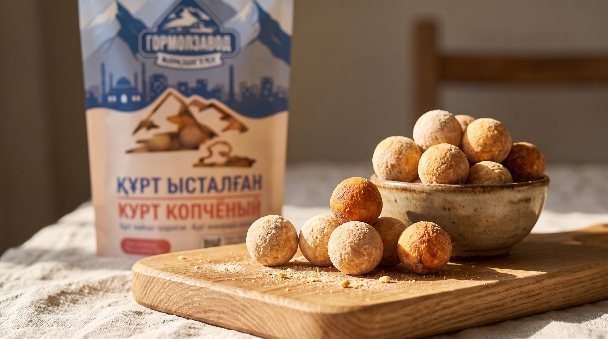

# Көкше Құрт

<p align="center">
  
</p>

<p align="center">
  Промо-лендинг для продукта <strong>«Көкше Құрт»</strong> от Гормолзавода Кокшетау.
  Сайт рассказывает о продукте, его составе и идее будущей промо-кампании.
</p>

<p align="center">
  <a href="#возможности">Возможности</a> ·
  <a href="#запуск">Запуск</a> ·
  <a href="#структура">Структура</a>
</p>

---

## О проекте

Одностраничный адаптивный сайт о копчёном курте из Кокшетау. Дизайн объединяет фирменную палитру, продуктовые фотографии и интерактивные элементы, чтобы познакомить посетителя с продуктом и будущей механикой промокодов.

> Промо-акция пока не запущена. Вводимый код не проверяется на сервере, а данные формы сохраняются только в браузере посетителя.

## Возможности

- Два языка интерфейса: казахский и русский.
- Адаптивная вёрстка для компьютеров и мобильных устройств.
- Переключение лицевой и обратной стороны упаковки.
- Просмотр упаковки в увеличенном виде.
- Форма ввода промокода и регистрационная форма.
- Информационные блоки о составе, качестве, истории бренда и примерах призов.
- Плавная навигация по разделам и мобильное меню.

## Стек

| Технология | Назначение |
| --- | --- |
| HTML5 | Семантическая структура страницы |
| CSS3 | Адаптивная вёрстка, анимации и стили |
| JavaScript | Переключение языка и интерактивные сценарии |

Проект не требует сборки, фреймворков или внешнего бэкенда.

## Запуск

1. Склонируйте репозиторий:

   ```bash
   git clone https://github.com/rainhoop/Kokshe_Kurt_Team_19_Gormolzavod.git
   ```

2. Откройте `index.html` в браузере.

Для более удобной локальной разработки можно запустить любой статический сервер, например через VS Code Live Server.

## Структура

```text
.
├── assets/       # Логотип, упаковка и изображения для блоков сайта
├── app.js        # Локализация и интерактивные компоненты
├── index.html    # Разметка лендинга
└── styles.css    # Стили и адаптивные правила
```

## Материалы

Все изображения, используемые в интерфейсе, находятся в папке `assets/`. При замене материалов сохраняйте имена файлов либо обновляйте соответствующие пути в `index.html`.

---

<p align="center">Сделано для Гормолзавода Кокшетау · Казахстан</p>
